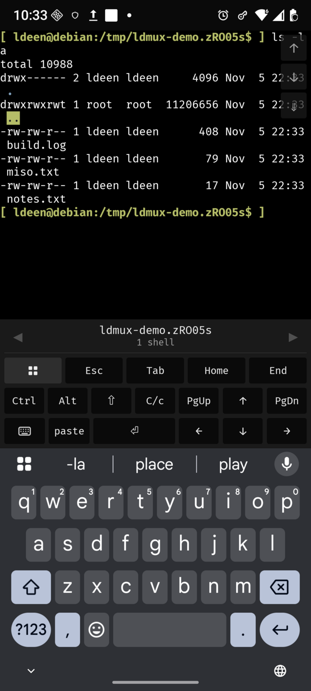
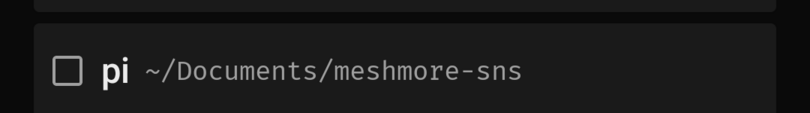

# ldmux

A terminal that lives on your own Linux machine and is reachable from your phone.
It works over your tailnet, or over a pair of LoRa radios when there is no network.

## What runs where

| Where | What |
|---|---|
| your Linux host | `ldmuxd` (the daemon), `ldmux-keeper` (owns the PTYs and the shells), `ldmux` (the CLI), desk windows (`ldmuxd attach`, or `ldmux window`) |
| your phone | the Android app: a native KMP/Compose client with its own VT emulator, no WebView |
| the radio, when there is one | a MeshCore radio on a serial port belongs to the host and the daemon drives it directly, and the phone drives its own radio over Bluetooth LE |

The keeper is the single source of truth. Every shell is a PTY owned by
`ldmux-keeper`, so a daemon restart does not end your shells, and the daemon talks to it
over a Unix socket. There is no tmux and no second session layer.

## The three modes

| Mode | Carried by | Notes |
|---|---|---|
| tailnet | a WebSocket to the daemon, bearer token, reachable only on your tailnet | instant handshake, the default |
| LoRa live | two MeshCore radios | keystrokes leave as you type |
| LoRa batch | the same radios | typing is collected and leaves as one batch when you send it, which is forced on a public channel |

Exclusivity is per shell, not per link. Whichever device holds a shell owns it, and a
second device that wants it is told so and offers to take it back; a device may hold many
shells, and the host accepts up to 64 connections.

<p align="center">
  
  
</p>

The phone opens shells as well as using them: a shell started from the app is marked on
its row, can be sent to a desk window on the host, and can be closed from the phone. The
row on the right is one of those.

A recording of the phone driving a shell over the tailnet:

[docs/media/04-tailnet-commands.mp4](docs/media/04-tailnet-commands.mp4)

**What each mode is for.** The tailnet is the fast one and the one to use when a network
is there: a WebSocket, a local terminal emulator, and scrolling with momentum like any
other terminal app. The radio modes exist for when there is no network at all. `live`
sends each keystroke as you type, which is what you want for a quick command on a link
you trust. `batch` collects your typing and sends it when you press `sync`, so a long
command costs one transmission instead of forty; it is forced on a public channel, where
the airtime is shared and every keystroke would otherwise be a broadcast. On the radio the
view moves by the scroll pad's buttons only — a scroll there is a transmission, and a fling
would spend airtime on movement nobody asked for.

## Getting it running on the host

Needs Linux x86_64, systemd (user units), and nix for the binaries.

```bash
nix run .#install                 # binaries, desk-window launcher, both user units
systemctl --user enable --now ldmux
ldmux list                        # what the keeper has
ldmux window ~                    # a shell in a desk window on the machine's own screen
```

`ldmux window` prints the session id. `ldmux --help` lists every verb, including
`shell`, `run`, `send`, `key`, `capture`, `live`, `mirror`, `kill` and `close`.

Replacing the keeper ends every shell it holds. `nix run .#restart-keeper` says so and
asks first, and the daemon and the CLI restart without touching a shell.

## Pairing a phone

Both routes pair by scanning a code from the host, in the app under Settings then pairing.

```bash
ldmux code                        # tailnet: address and token, for a phone on the same tailnet
ldmux code --mesh                 # adds the mesh session key and the pairing secret
ldmux code --mesh-only            # mesh keys only: no address, no token
```

`ldmux pair` prints the same thing as an `ldmux://` link. A `--mesh` code is as sensitive
as the token and the secret together.

For the radio route both radios have to be on the same frequency, bandwidth, spreading
factor and coding rate. No MeshCore channel key is involved: ldmux's records are direct
packets addressed to the peer's radio key, sealed by the session, so the channel preset is
a frequency to share and not a secret to match. `ldmux mesh status` prints the tuple the
host's radio is actually on, `ldmux mesh preset <MHz> <kHz> <SF> <CR>` sets it, and the
phone's radio panel can read a radio, adopt a public preset, or be given a tuple by hand.
`docs/ARCHITECTURE.md` section 11 is the whole procedure for the host side.

## Build and test

```bash
nix develop                       # rustc/cargo, zbar for the QR tests
scripts/test-parallel.py          # the gate: the same binaries as cargo test, in a pool
cargo clippy --workspace --all-targets -- -D warnings

scripts/android.sh build          # debug APK
scripts/android.sh install        # build, then adb install -r
scripts/android.sh test           # the Kotlin JVM suite, including the wire fixture
scripts/android.sh release        # signed APK     (needs signing inputs)
scripts/android.sh bundle         # signed AAB     (needs signing inputs)
```

The Android release is signed from `packages/mobile/keystore.properties` or from
`LDMUX_KEYSTORE*` in the environment, and the tasks fail loudly without it.
`versionCode` comes from `git rev-list --count HEAD`, with `LDMUX_VERSION_CODE` and
`LDMUX_VERSION_NAME` to override it. A release refuses to package unless both native
libraries are present for every shipped ABI, and it carries the licence texts that
`scripts/collect-licenses.sh` collects. `docs/RELEASE-AUDIT.md` appendix A has the listing material and the privacy policy.

The terminal engine is libghostty-vt, built from the single pinned Ghostty commit by a
nix derivation. `nix develop` exports `LDMUX_VT_LIB_DIR`, so plain `cargo` works inside
the shell. Outside it, point that variable at a directory holding `libghostty-vt.a`.

## Where to read more

- [`docs/ARCHITECTURE.md`](docs/ARCHITECTURE.md) is the depth: the layers, the wire, the
  invariants, the security model, the failure modes, and how to bring up the host radio.
- [`docs/RELEASE-AUDIT.md`](docs/RELEASE-AUDIT.md) is the open work, aspect by aspect, with
  the store submission material and the decisions still to make.
- [`docs/adr/`](docs/adr/) holds the decisions and the reasoning behind them.
- [`AGENTS.md`](AGENTS.md) is for agents working in this repo.
