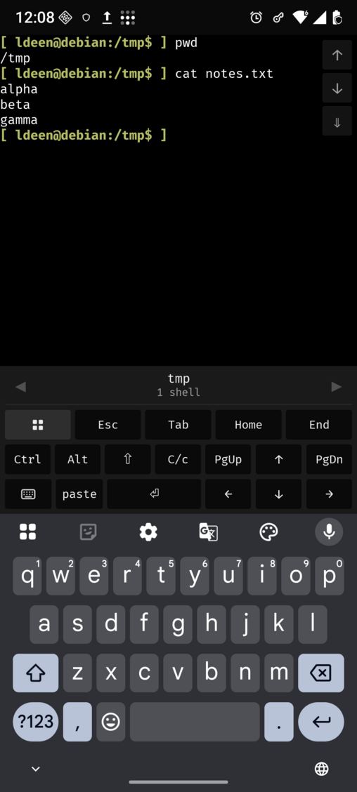

# ldmux

A terminal that lives on your own Linux machine, reachable from your phone: over your
tailnet, or over a pair of LoRa radios when there is no network at all.

| Where | What |
|---|---|
| your Linux host | `ldmuxd` (daemon), `ldmux-keeper` (owns every PTY and shell), `ldmux` (CLI), and desk clients in your own terminals (`ldmux attach`) |
| your phone | the Android app: a KMP/Compose client with its own VT emulator, no WebView |
| the radio route | a MeshCore companion radio on the host's serial port, which the daemon drives, and one the phone drives over Bluetooth LE |

The keeper is the source of truth. Every shell is a PTY it owns, so restarting the daemon
never ends a shell; replacing the keeper ends all of them, and the install script says so
before it does anything.

## The three modes

| Mode | Carried by | Notes |
|---|---|---|
| tailnet | a WebSocket to the daemon, bearer token, reachable only on your tailnet | instant handshake, the default |
| LoRa live | two MeshCore radios | keystrokes leave as you type |
| LoRa batch | the same radios | typing is collected and leaves as one batch on `sync`, forced on a public channel |

Exclusivity is per shell, not per link: whichever device holds a shell owns it, a second
device is told so and offers a takeover, one device may hold many shells, and the host
accepts up to 64 connections. A shell started from the phone is marked on its row, can be
sent to a desk window, and can be closed from the phone.

<p align="center">
  
  
  
  
</p>

Use the tailnet whenever a network is there: it is a WebSocket, the terminal is local, and
scrolling has momentum like any other terminal app. The radio modes exist for when there is
none. `live` sends each keystroke as you type. `batch` collects your typing and sends it on
`sync`, so a long command costs one transmission instead of forty; a public channel forces
it, because there the airtime is shared and every keystroke would be a broadcast. On the
radio the view moves by the scroll pad's buttons only, since a scroll is a transmission.

## Getting it running on the host

Linux x86_64, a systemd user session, and nix for the binaries.

```bash
nix run .#install                 # binaries, desk-window launcher, both user units
systemctl --user enable --now ldmux
ldmux list                        # what the keeper has
ldmux shell ~                     # a shell in *this* terminal
ldmux attach d8f92c0630           # an existing shell, in this terminal
ldmux new ~                       # create one and print its id, opening nothing
```

`ldmux` never opens a terminal window of its own: it runs inside the one you have, and
`super+Return` runs the installed `ldmux-terminal`, which opens your configured emulator
and starts `ldmux shell` in it. The one window the daemon opens is the one the phone asks
for (`send to desktop`), and it uses the terminal you configured: `ldmux terminal set
alacritty` pins it, otherwise `$TERMINAL`, `xdg-terminal-exec` and your desktop's own setting
decide. `ldmux terminal --explain` prints the answer and where it came from.

`ldmux --help` lists every verb (`new`, `shell`, `attach`, `terminal`, `send`, `key`,
`capture`, `kill`, `close`, `code`, `pair`, `mesh`, …). `ldmux --version` and `ldmux ping` say which
build is running. Replacing the keeper ends every shell: `nix run .#restart-keeper` says so
and asks first.

## Pairing a phone

Both routes pair by scanning a code from the host, in the app under Settings then pairing.

```bash
ldmux code                        # tailnet: address and token, for a phone on the same tailnet
ldmux code --mesh                 # adds the radio's session key, secret and tuple
ldmux code --mesh-only            # radio keys only: no address, no token
```

`ldmux pair` prints the same as an `ldmux://` link, and a code can be pasted if the phone
cannot scan. A `--mesh` code is as sensitive as the token and the secret together.

For the radio route the two radios must be on the same frequency, bandwidth, spreading
factor and coding rate. No MeshCore channel key is involved: records are direct packets
addressed to the peer's radio key and sealed by the session, so the channel preset is a
frequency to share, not a secret to match. The code carries the host radio's tuple, so the
app can compare it with its own radio and match it in one press. `ldmux mesh status` prints
the tuple the host is on and `ldmux mesh preset <MHz> <kHz> <SF> <CR>` sets it. The radio
link is one hop in one direction: a phone reaching the host through a relay attaches and
never hears a reply (`docs/ARCHITECTURE.md` section 11).

## Build and test

```bash
nix develop                       # rustc/cargo, zbar for the QR tests
scripts/test-parallel.py          # the gate: the same binaries as cargo test, in a pool
cargo clippy --workspace --all-targets -- -D warnings

scripts/android.sh test           # the Kotlin JVM suite, including the wire fixture
scripts/android.sh build          # debug APK
scripts/android.sh install        # build, then adb install -r
scripts/android.sh release|bundle # signed APK / AAB (needs the signing inputs)
```

A release is signed from `packages/mobile/keystore.properties` or `LDMUX_KEYSTORE*` in the
environment and fails loudly without it. `versionCode` is `git rev-list --count HEAD`
(`LDMUX_VERSION_CODE` overrides it), the bundle refuses to package unless both native
libraries are present for every shipped ABI, and it carries the licence texts
`scripts/collect-licenses.sh` collects. The store material and the privacy policy are in
`docs/RELEASE-AUDIT.md` appendix A.

The terminal engine is libghostty-vt, built from one pinned Ghostty commit by a nix
derivation. `nix develop` exports `LDMUX_VT_LIB_DIR`; outside the shell, point it at a
directory holding `libghostty-vt.a`.

## Where to read more

- [`docs/ARCHITECTURE.md`](docs/ARCHITECTURE.md): layers, wire, invariants, security,
  failure modes, platform support, and how to bring up the host radio.
- [`docs/RELEASE-AUDIT.md`](docs/RELEASE-AUDIT.md): every way this can fail, what is fixed,
  what is open, and the decisions still to make.
- [`docs/adr/`](docs/adr/): the decisions and the reasoning behind them.
- [`AGENTS.md`](AGENTS.md): for agents working in this repo.
