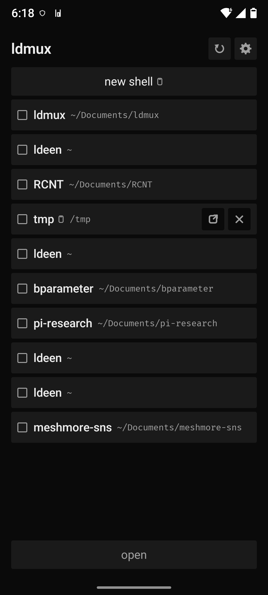
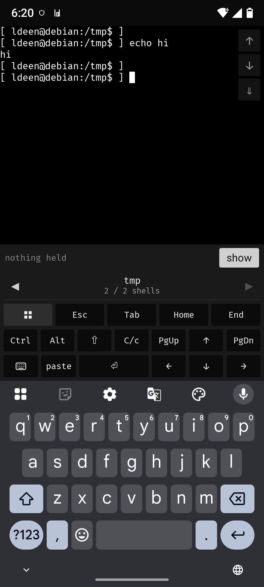
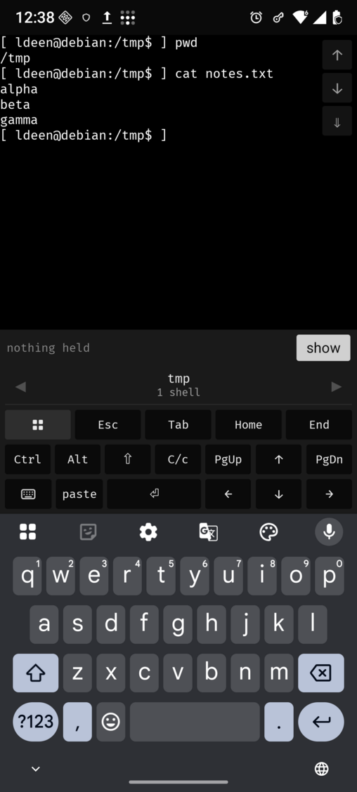
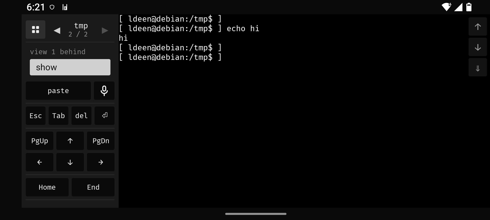

<p align="center">
  
</p>

# Ldmux

A remote terminal: shells run on a Linux desktop and are used from a phone. Two transports — the
tailnet, or a pair of LoRa radios when there is no internet at all.

## What it does

- **Shells live on the desktop.** `ldmux-keeper` owns every PTY and supervises every shell, so
  restarting the daemon ends nothing. Replacing the keeper ends all of them, and says so first.
- **The phone is a real terminal.** The app renders with libghostty-vt, the engine the keeper
  runs, and parses the wire itself. No WebView, no browser, no remote desktop.
- **Two transports, one behaviour.** A WebSocket over the tailnet when there is a network; LoRa
  radios when there is not. Same panes, same keys, same ownership.
- **The radios are optional.** The tailnet needs no radio. The offline mode needs **two or more
  MeshCore radios**: one on the desktop's serial port and one that travels with the phone over
  Bluetooth, plus any repeaters in between. Both ends must share one frequency, bandwidth,
  spreading factor and coding rate. Repeaters need a route at both ends: the desktop floods an
  advert so its radio is discoverable, and the reply direction follows the path a record arrived
  by (`docs/ARCHITECTURE.md` §11 states what the phone still has to do to learn its own route).
- **Records are sealed end to end.** Each is a Noise session message inside a MeshCore
  `RAW_CUSTOM` packet addressed to the peer radio's key; the radio's own channel encryption is
  never used. [`docs/SECURITY.md`](docs/SECURITY.md).
- **One owner per shell.** A second device is told who holds it and offered a takeover, never
  displaced silently.
- **LoRa stays affordable.** Batch mode sends forty keystrokes as one transmission on `sync`, so a
  command costs a fraction of the air typing it live would, and the 1 % allowance a European band
  requires is enforced on both ends ([`docs/AIRTIME.md`](docs/AIRTIME.md)).
- **A shell can say it is done.** `ldmux buzz` marks a shell in the app's list — finished a turn, or
  waiting for the operator — and the mark is cleared by opening it. No banner by default; an optional
  notification exists for the tailnet route, and `contrib/skills/ldmux-buzz` ships the agent skill
  that rings it at the end of a turn.

## Components

| Where | What |
|---|---|
| Linux desktop | `ldmuxd` (daemon), `ldmux-keeper` (owns every PTY), `ldmux` (CLI), desk clients in an existing terminal (`ldmux attach`) |
| phone | the Android app: KMP/Compose with a native terminal renderer |
| radios | a MeshCore companion radio on the desktop's serial port, driven by the daemon, a second one on the phone over Bluetooth, and any repeaters between them |

## Modes

| Mode | Carried by | Notes |
|---|---|---|
| tailnet | a WebSocket | instant handshake, scrolling with momentum |
| LoRa live | the radios | keystrokes leave as typed |
| LoRa batch | the radios | typing leaves as one batch on `sync`, forced on a public channel |

<p align="center">
  
  
  
</p>
<p align="center">
  
</p>

## The app

- **First run** is an unpaired launcher: `scan a code`, `paste a link`, `use the radio`.
- **Launcher**: `new shell` first (asks for a path, empty means home), then the desktop's shells.
  Ticked rows become pages, numbered in tick order; `open` is the one action, dimmed while the
  desktop is unreachable.
- **Row menu**: a phone glyph marks a shell this phone started, `send to desktop` opens a
  workspace picker, `close shell` appears only for those, amber `no window` only when a window
  went away.
- **Between shells**: swipe the page or use the header arrows, which read `2 / 3 shells`. A shell
  another device holds reads `in use on <device>`, with one `take it back`.
- **Keys, portrait**: `Esc` `Tab` `Home` `End`, `Ctrl` `Alt` `⇧` latches, `C-c`, `paste`, enter, an
  arrow pad with `PgUp` `PgDn`, a key that hides the keyboard, and the launcher.
- **Keys, landscape**: `paste` and a microphone, `Esc` `Tab` `del` enter, the same pad, `Home`
  `End`, `C-c | - /`. Nothing latches; there is no soft keyboard.
- **Text size**: the `−` `+` stepper or a two-finger pinch; a bigger font reflows the shell.
  `controls` is compact or comfortable; `panel` is left or right, in landscape.
- **Scrolling**: drag and fling on the tailnet, or the `↑` `↓` `⇓` pad on both transports. A page
  is the pane less two rows; typing returns the view to live.
- **Selection**: long-press and drag with the platform's handles; releasing copies. A program's
  copy is capped at 100 000 characters, stripped of control characters, and refused unless the
  desktop allows it.
- **Tap** moves the cursor: a click for a program that tracks the mouse, arrow keys for a prompt.
- **Dictation** types into the shell from the panel's microphone, prefers on-device recognition,
  and says when it falls back to a cloud recogniser. Portrait uses the keyboard's own.
- **Predictive echo** draws a keystroke before the desktop answers while the link is slow, turns
  itself off below the threshold, and never at a password prompt.
- **Leaving the screen** keeps the pages for 45 seconds behind a notification, then detaches them and
  releases their claims while the shell keeps running. On the tailnet the app stays reachable behind
  that notification while it is paired, so a shell's mark can arrive with no page open; the radio
  route does not hold a session open for it and delivers the marks on the next attach instead.
- **Settings**: `link` (transport: `tailnet` or `LoRa radio`), `pairing` (token fingerprint,
  `pair` / `paste` / `unpair`), `diagnostics` (desktop, transport, radio, build, and an in-memory
  log with `copy` and `show`), `shells` (one notification when a shell finishes, off by default), `display`.
- **Radio setup** is in the app: pick the phone's radio over Bluetooth, choose a preset (region
  presets, the public table, `randomise`, `restore`, or a `custom` `MHz kHz SF CR`), `apply`. The
  desktop's radio row has one `match` that copies the four numbers and nothing else.
- **Input mode** is `live` or `batch`; `live` is refused on a public channel; the 36 second an
  hour limit is forced on between 869.4 and 869.65 MHz. The desktop applies the same allowance
  from the tuple the radio reports.
- **Batch bar**: the held text and its cost (`12 characters, 1 record`), then `sending…`,
  `waiting for the answer` (until the desktop says the pane settled), or `no answer yet`, and
  `view N behind` when the screen has fallen behind. One button: `sync` while text waits, `show`
  when only screens do; held text is dropped when leaving the page.
- **Limits**: 64 live shells (`LDMUX_MAX_SESSIONS`), 10 000 lines or 40 MiB of scrollback each.
- **Android 9 or newer**, `arm64-v8a` or `x86_64`, Tailscale signed in for the tailnet. There is
  no iOS client yet. One is planned, and it will be tailnet only, because the radio route's
  MeshCore library is Java for Android and would have to be written again for iOS.

`scripts/android.sh install` builds and installs over adb; there is no store listing.

## The desktop

Linux x86_64, a systemd user session, and nix for the binaries.

```bash
nix run .#install                 # binaries, desk-window launcher, both user units
systemctl --user enable --now ldmux
ldmux list                        # what the keeper has
ldmux shell ~                     # a shell in the current terminal
ldmux attach d8f92c0630           # an existing shell, in the current terminal
ldmux new ~                       # create one, print its id, open nothing
```

`ldmux` never opens a terminal window: it runs inside the one it was started from.

- A keybinding is left to the operator: `ldmux-terminal` opens the configured emulator and runs
  `ldmux shell` in it.
- The one window the daemon opens is the one the phone asks for (`send to desktop`), in the
  terminal configured for that desktop. `ldmux terminal set alacritty` pins it; otherwise
  `$TERMINAL`, `xdg-terminal-exec` and the desktop's own setting decide. `ldmux terminal
  --explain` reports which, and where the answer came from.

Every verb: `ping`, `list`, `new`, `shell`, `attach`, `terminal`, `send`, `key`, `capture`, `kill`,
`close`, `forget`, `adopt`, `mesh`, `code`, `pair`, `clipboard-write`. Options: `attach
--readonly`, `capture --history`, `list --all|--json`, `shell --name|--cwd`. `ldmux --version` and
`ldmux ping` report the running build. `nix run .#restart-keeper` ends every shell the keeper
owns, after printing that it will.

## Pairing

Both transports pair by scanning a code from the desktop: from the unpaired launcher on a fresh
install, and afterwards from Settings then `pairing`.

```bash
ldmux code                        # tailnet: address and token, for a phone on the same tailnet
ldmux code --mesh                 # adds the radio's session key, secret and tuple
ldmux code --mesh-only            # radio keys only: no address, no token
```

`ldmux pair` prints the same as an `ldmux://` link; a code can be pasted instead of scanned. A
`--mesh` code is as sensitive as the token and the secret together
([`docs/SECURITY.md`](docs/SECURITY.md)).

Both radios must share one frequency, bandwidth, spreading factor and coding rate; repeaters in
between may use their own presets, as MeshCore handles that. No MeshCore
channel key is involved: records are direct packets addressed to the peer's radio key and sealed
by the session, so a preset is a frequency to share, not a secret to match. The code carries the
desktop radio's tuple, so the app compares it with its own radio and matches it in one press.
`ldmux mesh status` prints the tuple; `ldmux mesh preset <MHz> <kHz> <SF> <CR>` sets it. Across
repeaters the desktop advertises itself on open and every five minutes (`LDMUX_MESH_ADVERT_SECS`),
the phone reads the route out of the advert it heard, and every reply follows the path the request
arrived by (`docs/ARCHITECTURE.md` §11).

## Build and test

```bash
nix develop                       # rustc/cargo, zbar for the QR tests
scripts/test-parallel.py          # the gate: the same binaries as cargo test, in a pool
cargo clippy --workspace --all-targets -- -D warnings

scripts/android.sh test           # the Kotlin JVM suite, including the wire fixture
scripts/android.sh build          # debug APK
scripts/android.sh install        # build, then adb install -r
scripts/android.sh release|bundle # signed APK / AAB, needs the signing inputs
```

Release rules, each of which fails the build rather than the upload: signing from
`packages/mobile/keystore.properties` or `LDMUX_KEYSTORE*`; `versionCode` from `git rev-list
--count HEAD` (override `LDMUX_VERSION_CODE`); R8 with keep rules for JNI, manifest components and
Compose members; both native libraries for every shipped ABI; licence texts collected; the Kotlin
suite passing. Store material and the privacy policy are in `docs/RELEASE-AUDIT.md` appendix A.

The terminal engine is libghostty-vt, built from one pinned Ghostty commit by a nix derivation.
`nix develop` exports `LDMUX_VT_LIB_DIR`; outside the shell, point it at a directory holding
`libghostty-vt.a`. The Android SDK and NDK are host-provided (the mobile devShell finds
`$HOME/Android/Sdk`), so `scripts/android.sh test` stops at "SDK location not found" without them.

## Documents

- [`docs/SECURITY.md`](docs/SECURITY.md): what each transport protects, what it does not, where
  secrets live.
- [`docs/ARCHITECTURE.md`](docs/ARCHITECTURE.md): layers, wire, invariants, failure modes, platform
  support, and radio bring-up.
- [`docs/RELEASE-AUDIT.md`](docs/RELEASE-AUDIT.md): every way this fails, what is fixed, what is
  open.
- [`docs/adr/`](docs/adr/): one record per decision, indexed in
  [`README.md`](docs/adr/README.md).
- [`AGENTS.md`](AGENTS.md): for agents working in this repository.
